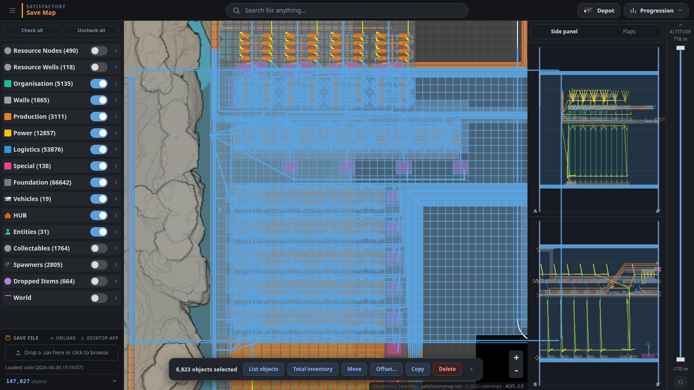

# Height view (2.5D)

A fork of Valentin's
[Satisfactory Save Map](https://github.com/valentinps/satisfactorymap).
The original map is top-down. This one adds **vertical Cuts** through a
selected slice of the factory, plus a shared **Z band**, so stacked floors
are readable as elevation.

**WIP.** For personal use, still in progress. Free to take if it looks
useful to you.

Drop a `.sav` in the browser — parsed on your machine, nothing uploaded.
Right-click-drag a rectangle to isolate an XY box. Height view opens on
that box.

## How it works

Height view is an isolation mode on the current map tab, not a second 3D
scene.

- **Cuts** — two elevation strips of whatever sits in the box: **A–A′**
  along X and **B–B′** along Y, each plotted as along × Z. Click **A / A′**
  or **B / B′** to reverse that Cut (swap ends and the depth reading).
- **Z band** — a shared elevation window on both Cuts. Drag the band or its
  min/max handles to peel: objects inside the box *and* the band become the
  active selection; out-of-band marks fade; buildings that only overlap the
  box from outside show as yellow dashed marks.
- **Layout** — **Side panel** (default): Cuts stacked to the left of the
  **Altitude** rail, A–A′ on top, B–B′ below. **Flaps**: the same Cuts
  overlay the isolation box on the map.
- **One-axis edit** after commit — drag a map-edge handle or the matching
  Cut vertical (A/A′ = X, B/B′ = Y). The opposite side stays put; the Z
  band is not reset.
- **Lines that cross** the box between vertices (belts, pipes, rails, …)
  count as occupants, not only points that sit inside the rectangle.
- The map's **Altitude** filter still caps Z. Clear the selection to
  dismiss Height view.

Building table height is not in the save payload; point marks on a Cut use
a 4 m placeholder AABB.

The rest of the client — layers, search, inventory, save editing — is still
the original map. Build and run it the same way:

## Building from source

Everything — site, parser, desktop app, data extraction — is covered in
[CONTRIBUTING.md](CONTRIBUTING.md).

## Credits & save-format lineage

The Rust parser is a port of
[GreyHak/sat_sav_parse](https://github.com/GreyHak/sat_sav_parse), validated
field-by-field against the Python reference with bit-exact differential
gates. The static world tables (resource nodes, slugs, crash sites…) were
originally converted from that project; they now regenerate from the game's
own level data (validated 1:1 against the originals — see
`game_data/extractors/extract_collectables.py`). This project wouldn't
exist without GreyHak's format work.

## License & trademark

The code is licensed under [AGPL-3.0](LICENSE) — the parser port with
GreyHak's written permission, since the upstream it derives from is
GPL-3.0-only (scope recorded in [NOTICES.md](NOTICES.md)). The
**Satisfactory Save Map** name, logo, and the `satisfactorymap.net` domain
are *not* covered by that license: forks and rehosts are welcome under the
AGPL, but must use their own name and domain, must preserve the copyright
and license notices (including the in-app footer), and — being AGPL — must
publish their source, including when only serving the app. The canonical
instance is [satisfactorymap.net](https://satisfactorymap.net/).

Satisfactory is a trademark of Coffee Stain Studios. The game-derived data
(icons, map image, item/building/world tables) belongs to Coffee Stain
Studios: none of it is committed here — it is extracted from your own copy of
the game by `game_data/extract_all.py`, or unpacked from the convenience
archive attached to a release (see [game_data/README.md](game_data/README.md)
and [CONTRIBUTING.md](CONTRIBUTING.md)). This project is not affiliated with
or endorsed by Coffee Stain Studios.
